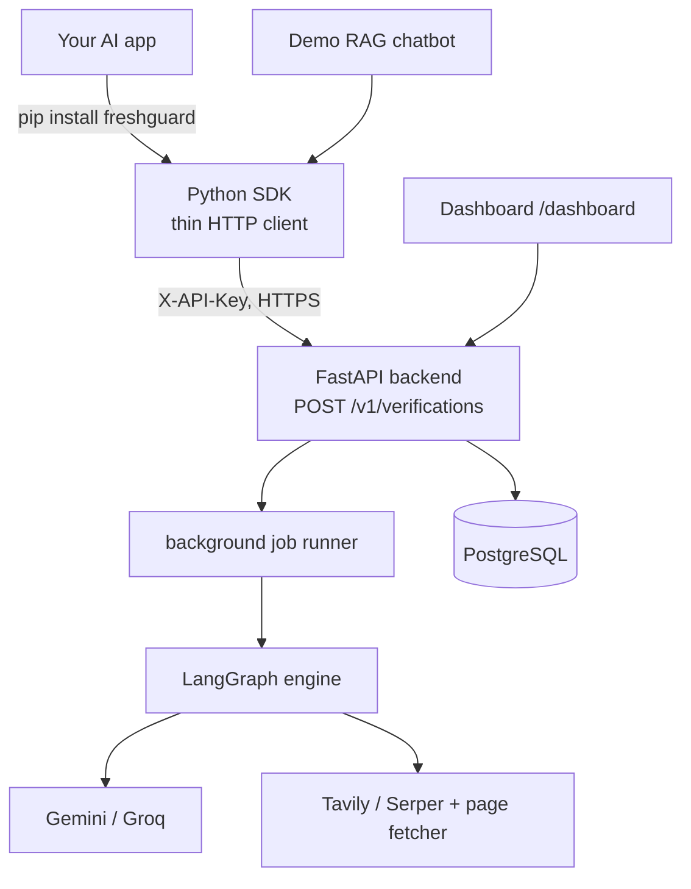

# FreshGuard

**Catch stale answers before your users do.**

AI apps answer confidently from knowledge that has quietly gone out of date: the CEO changed,
a new version shipped, a law was replaced. FreshGuard checks an AI answer against current web
sources, labels it, and shows the evidence it relied on. It never guesses: when it cannot find
trustworthy evidence, the label is `unverifiable`.

| Label | Meaning |
|---|---|
| `fresh` | Credible, recent evidence supports the claim |
| `stale` | Credible, recent evidence contradicts the claim (with a quoted source and a suggested correction) |
| `potentially_stale` | Evidence is weak, old, undated or conflicting: a human should look |
| `unverifiable` | Not enough trustworthy evidence. FreshGuard does not guess |

An answer with several claims gets its **worst** claim's label (`stale` > `potentially_stale` >
`unverifiable` > `fresh`).

Live API docs: `https://freshguard-api-uea0.onrender.com/docs` ·
Dashboard: `https://freshguard-api-uea0.onrender.com/dashboard` (needs the API key)

## Why you can trust a verdict

1. **LLMs do language work only.** They extract claims, classify how fast a claim goes out of
   date, compare what a source says with the claim, and draft a correction. They never score,
   tier sources, or pick the final label.
2. **The decision is deterministic code.** Three source tiers (official/government, major news and reference sites, everything else),
   freshness windows (fast 30 days, slow 365, static none) and a decision table
   (`docs/RULES.md`) produce the label. Same evidence in, same label out.
3. **Every quote is verified.** A quote shown as evidence must be a verbatim substring of a page
   we fetched. If it is not, it is discarded. The model cannot invent a source.
4. **Weak evidence stays weak.** Undated or low-tier sources can never make a claim `fresh` or
   `stale`. A credible supporting source plus any verified contradiction gives
   `potentially_stale`, never `fresh`.
5. **Provider failures are visible.** If the model or search provider is down, the job is
   `failed`, never a made-up verdict.

## How it works

```mermaid
flowchart LR
    A[Question + AI answer] --> B[extract claims]
    B --> C[classify volatility<br/>fast / slow / static]
    C -->|static| Z[decide]
    C --> D[generate search queries]
    D --> E[retrieve evidence<br/>Tavily / Serper + page fetch]
    E -->|none found: reformulate once| D
    E --> F[validate sources<br/>tier + date]
    F --> G[compare stance<br/>supports / contradicts]
    G --> H[check quote integrity<br/>verbatim or discarded]
    H --> Z[decide<br/>deterministic rules]
    Z --> I[suggest correction<br/>grounded in cited quotes]
    I --> J[label + evidence]
```



The graph is built with **LangGraph**; model and search calls go through **LangChain** adapters
behind our own interfaces (Gemini with a Groq fallback, Tavily with a Serper fallback).



The verification engine (`backend/app/engine/`) never imports the API, database or services
layers; this is enforced by a test.

## Try it

**Dashboard.** Open `/dashboard`, paste the API key, and use "Check a new answer".

**Python SDK**

```python
from freshguard import FreshGuard

fg = FreshGuard("https://freshguard-api-uea0.onrender.com", api_key="...")
result = fg.verify("Who is the CEO of Twitter?", "Jack Dorsey is the CEO of Twitter.")
print(result.label)                 # stale
print(result.suggested_correction)
for claim in result.claims:
    for e in claim.evidence:
        print(e.stance, e.url, e.quoted_span)
```

Verification takes 10-60 seconds, so apps should reply to the user first and verify in the
background (`fg.submit(...)` then `fg.wait(id)`), then show a badge. To re-check an old answer
later: `fg.reverify(id)`.

**HTTP**

```bash
curl -X POST "$URL/v1/verifications?wait=true&timeout=90" \
  -H "X-API-Key: $KEY" -H "Content-Type: application/json" \
  -d '{"question":"Who is the CEO of Twitter?","answer":"Jack Dorsey is the CEO of Twitter."}'
```

Full contract: `docs/API.md`, `docs/INTEGRATION_GUIDE.md`.

## Demo: a RAG chatbot with an outdated knowledge base

`demo/` is a LangGraph + Gemini + Chroma chatbot whose knowledge base deliberately contains old
facts. It answers at once; FreshGuard verifies in the background and a badge appears on the
message (red "Out of date" with the correction and source, amber, green, or grey). See
`demo/README.md`.

## Benchmark

`benchmark/` holds 81 hand-labeled claims (stale, fresh, unverifiable; single-claim, static,
unknowable and multi-claim), with ground truth checked against dated sources on 2026-11-13.

First full run (58 of 81 claims completed; 23 failed because the free-tier model quota ran out,
so they are not counted):

| Measure | Result |
|---|---|
| Harmful errors (stale shown as fresh, invented answer to an unknowable claim, false stale alarm) | 2 of 58 (3%) |
| Stale answers flagged (`stale` or `potentially_stale`) | 93% |
| Stale answers labeled exactly `stale` | 44% |
| Unknowable claims correctly `unverifiable` | 89% |
| Exact accuracy | 52% |
| Median / p90 latency | 33 s / 48 s |

How to read this honestly:
- The system errs on the side of caution. Many correct-but-weakly-sourced answers come back
  `potentially_stale` instead of `fresh` (45% of fresh claims were labeled exactly `fresh`).
  A cautious label is a "please look", not a wrong answer.
- Both harmful errors led to fixes (see `docs/DECISIONS.md` D40 and D43): one was a stance
  misread of an ended role, the other a stale claim wrongly classed as static.
- Some of these results were produced by earlier versions of the rules, and some claims could
  not run. A re-run on the final code is the next step. Report: `benchmark/README.md`.
- 81 claims is a small sample. Treat these numbers as a measurement of behavior, not a
  guarantee.

Reproduce: start the backend, then `cd benchmark && python run_benchmark.py --limit 10`.

## Repository layout

```
backend/     FastAPI service + LangGraph verification engine
sdk/         Python client (pip install freshguard)
benchmark/   Labeled claims, runner, metrics, report
demo/        Demo RAG chatbot (FastAPI + React)
docs/        API contract, rules, node design, decisions, deployment
render.yaml  Render blueprint for the hosted API
```

## Run it locally

```bash
cd backend
python -m venv .venv && source .venv/bin/activate     # Windows: .venv\Scripts\activate
pip install -e ".[dev]"
cp .env.example .env                                   # add Gemini/Groq and Tavily keys
uvicorn app.main:app --port 8000
pytest -q && ruff check .
```

Deployment (Render + Neon Postgres): `docs/DEPLOY.md`.

## Known limits

- Verification is slow on free-tier models (10-60 s) and quota-limited; jobs run in-process, so a
  server restart marks running jobs failed (they can be resubmitted).
- Evidence quality depends on what the search provider returns. Some trusted sites block
  automated fetching (HTTP 403), and many pages have no machine-readable date, which keeps
  their evidence "weak".
- Suggested corrections are only as current as the cited sources; the dashboard says so.
- Re-verification is caller-driven (`reverify`); there is no built-in scheduler yet.

See `AGENTS.md` for the engineering rules and `docs/DECISIONS.md` for why things are built this way.