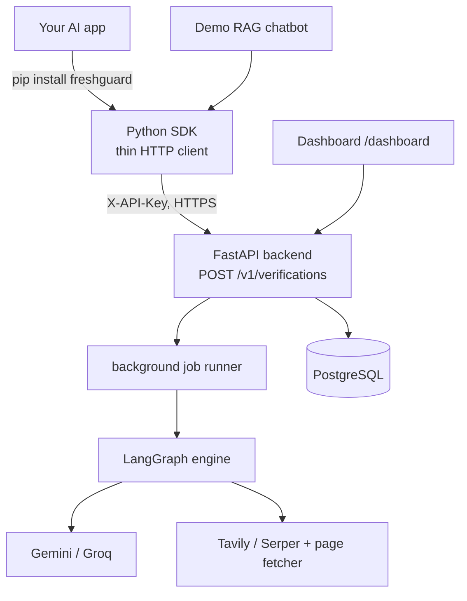
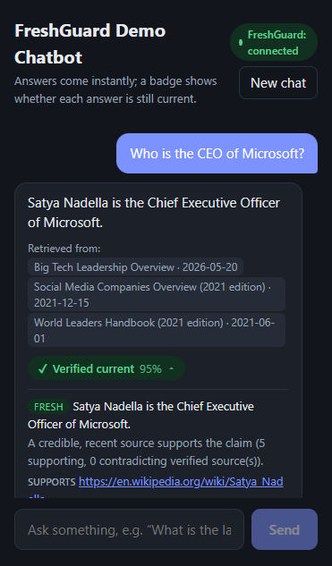
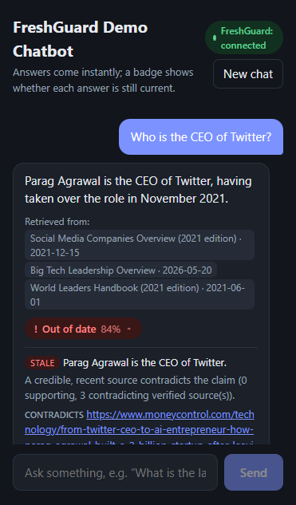

# FreshGuard

**Catch stale answers before your users do.**

Team KIZUNA, Global AI Hackathon (Tavily: Stale-Answer Detector).  
**[Watch the demo video](https://drive.google.com/file/d/1cRhJRPCTnj9ciTKxgaG9zsYetkbUen6g/view?usp=sharing)**

AI apps answer confidently from knowledge that has quietly gone out of date: the CEO changed,
a new version shipped, a law was replaced. FreshGuard checks an AI answer against current web
sources, labels it, and shows the evidence it relied on. It never guesses: when it cannot find
trustworthy evidence, the label is `unverifiable`.

| Label | Meaning |
|---|---|
| `fresh` | Credible, recent evidence supports the claim |
| `stale` | Credible, recent evidence contradicts the claim (with a quoted source and a suggested correction) |
| `potentially_stale` | Evidence is weak, old, undated or conflicting: a human should look |
| `unverifiable` | Not enough trustworthy evidence. FreshGuard does not guess |

An answer with several claims gets its **worst** claim's label (`stale` > `potentially_stale` >
`unverifiable` > `fresh`).

Live API docs: `https://freshguard-api-uea0.onrender.com/docs` ·
Dashboard: `https://freshguard-api-uea0.onrender.com/dashboard` (needs the API key)

## Why you can trust a verdict

1. **LLMs do language work only.** They extract claims, classify how fast a claim goes out of
   date, compare what a source says with the claim, and draft a correction. They never score,
   tier sources, or pick the final label.
2. **The decision is deterministic code.** Three source tiers (official/government, major news and reference sites, everything else),
   freshness windows (fast 30 days, slow 365, static none) and a decision table
   (`docs/RULES.md`) produce the label. Same evidence in, same label out.
3. **Every quote is verified.** A quote shown as evidence must be a verbatim substring of a page
   we fetched. If it is not, it is discarded. The model cannot invent a source.
4. **Weak evidence stays weak.** Undated or low-tier sources can never make a claim `fresh` or
   `stale`. A credible supporting source plus any verified contradiction gives
   `potentially_stale`, never `fresh`.
5. **Provider failures are visible.** If the model or search provider is down, the job is
   `failed`, never a made-up verdict.

## How it works

```mermaid
flowchart LR
    A[Question + AI answer] --> B[extract claims]
    B --> C[classify volatility<br/>fast / slow / static]
    C -->|static| Z[decide]
    C --> D[generate search queries]
    D --> E[retrieve evidence<br/>Tavily / Serper + page fetch]
    E -->|none found: reformulate once| D
    E --> F[validate sources<br/>tier + date]
    F --> G[compare stance<br/>supports / contradicts]
    G --> H[check quote integrity<br/>verbatim or discarded]
    H --> Z[decide<br/>deterministic rules]
    Z --> I[suggest correction<br/>grounded in cited quotes]
    I --> J[label + evidence]
```



The graph is built with **LangGraph**; model and search calls go through **LangChain** adapters
behind our own interfaces (Gemini with a Groq fallback, Tavily with a Serper fallback).



The verification engine (`backend/app/engine/`) never imports the API, database or services
layers; this is enforced by a test.

## How Tavily is used

Tavily is the evidence engine. For each time-sensitive claim the model writes search queries
(for example "Twitter CEO 2026"), and `TavilySearch` returns ranked results. Search snippets are
not trusted as evidence on their own. For every hit FreshGuard:

1. fetches the full page and reads its publish and last-modified dates;
2. assigns a source tier (official, major newsroom, other) with deterministic code;
3. asks the model whether the page supports or contradicts the claim and to copy a quote;
4. keeps the quote only if it is a verbatim substring of the fetched page.

If Tavily returns nothing useful, the claim is re-queried once, and if there is still no
evidence the label is `unverifiable`. Serper is a fallback provider behind the same interface.

## Technologies used

| Area | Technology |
|---|---|
| Web search / evidence retrieval | **Tavily** (primary), Serper (fallback) |
| LLMs (extract claims, classify volatility, compare stance, draft corrections) | Google Gemini, Groq fallback, via LangChain adapters |
| Orchestration | LangGraph |
| Backend API | FastAPI, Pydantic v2, SQLAlchemy |
| Database | PostgreSQL (Neon), SQLite for local tests |
| Client | Python SDK on PyPI (`pip install freshguard`, httpx) |
| Dashboard | One embedded HTML/JS page served by the API |
| Demo app | LangGraph + Gemini + Chroma RAG chatbot, React UI |
| Deployment | Docker, Render |
| Quality | pytest, ruff, GitHub Actions CI |

## Try it

**Dashboard.** Open `/dashboard`, paste the API key, and use "Check a new answer".

**Python SDK**

```python
from freshguard import FreshGuard

fg = FreshGuard("https://freshguard-api-uea0.onrender.com", api_key="...")
result = fg.verify("Who is the CEO of Twitter?", "Jack Dorsey is the CEO of Twitter.")
print(result.label)                 # stale
print(result.suggested_correction)
for claim in result.claims:
    for e in claim.evidence:
        print(e.stance, e.url, e.quoted_span)
```

Verification takes 10-60 seconds, so apps should reply to the user first and verify in the
background (`fg.submit(...)` then `fg.wait(id)`), then show a badge. To re-check an old answer
later: `fg.reverify(id)`.

**HTTP**

```bash
curl -X POST "$URL/v1/verifications?wait=true&timeout=90" \
  -H "X-API-Key: $KEY" -H "Content-Type: application/json" \
  -d '{"question":"Who is the CEO of Twitter?","answer":"Jack Dorsey is the CEO of Twitter."}'
```

Full contract: `docs/API.md`, `docs/INTEGRATION_GUIDE.md`.

## Demo: a RAG chatbot with an outdated knowledge base

`demo/` is a LangGraph + Gemini + Chroma chatbot whose knowledge base deliberately contains old
facts. It answers at once; FreshGuard verifies in the background and a badge appears on the
message (red "Out of date" with the correction and source, amber, green, or grey). See
`demo/README.md`.

| A current answer | An out-of-date answer |
|---|---|
|  |  |

## Benchmark

`benchmark/` holds 81 hand-labeled claims (stale, fresh, unverifiable; single-claim, static,
unknowable and multi-claim), with ground truth checked against dated sources.

Full run on the final code, all 81 claims completed (2026-11-16):

| Measure | Result |
|---|---|
| Exact accuracy | 84% (68 of 81) |
| Harmful errors (stale shown as fresh, invented answer to an unknowable claim, false stale alarm) | 0 of 81 |
| Stale answers flagged (`stale` or `potentially_stale`) | 97% (36 of 37) |
| Stale answers labeled exactly `stale` | 76% (28 of 37) |
| Stale answers shown as `fresh` | 0% |
| Fresh answers labeled exactly `fresh` | 88% (29 of 33); the other 4 were `potentially_stale` |
| Unverifiable claims labeled `unverifiable` | 100% (11 of 11) |
| Median / p90 latency | 31 s / 60 s |

How to read this honestly:
- The system errs on the side of caution. All 13 misses are cautious labels
  (`potentially_stale` or `unverifiable`); none is a confident wrong answer. A cautious
  label is a "please look", not a wrong answer. The weakest area is tech and product claims
  (6 of 13 exact), where sources are often low-tier or undated.
- One claim, "Jack Dorsey is the CEO of Twitter", came back `unverifiable` in this run (no
  verified evidence was found) although it was `stale` in earlier runs. Search results vary
  from run to run.
- **A ground-truth label was corrected after this run.** The run flagged "Jensen Huang is the
  CEO of Nvidia" as `stale`, and the dataset said `fresh`. Nvidia's Form 8-K shows Huang resigned
  as CEO on 2026-11-12 ([source](https://www.sec.gov/Archives/edgar/data/0001045810/000104581026000082/nvidiaannouncesceotransiti.htm)),
  so FreshGuard was right and the label had gone out of date. We corrected it (`c037`, see
  `docs/DECISIONS.md` D46). Before the correction the run showed 1 harmful error and 83%
  accuracy. We show the corrected numbers and say so. This is also a small demonstration of the problem the
  project solves: facts change under you.
- Earlier rule changes (D38 to D45) were made after looking at earlier benchmark runs on the same
  claims, so this is a development benchmark, not a blind test. 81 claims is a small sample.
  Treat the numbers as a measurement of behavior, not a guarantee.

Reproduce: start the backend, then `cd benchmark && python run_benchmark.py --concurrency 1`.
Details and the full miss list: `benchmark/README.md`.

## Repository layout

```
backend/     FastAPI service + LangGraph verification engine
sdk/         Python client (pip install freshguard)
benchmark/   Labeled claims, runner, metrics, report
demo/        Demo RAG chatbot (FastAPI + React)
docs/        API contract, rules, node design, decisions, deployment
render.yaml  Render blueprint for the hosted API
```

## Run it locally

You need Python 3.11+ and API keys for Gemini (or Groq) and Tavily.

**1. Backend**

```bash
cd backend
python -m venv .venv && source .venv/bin/activate     # Windows: .venv\Scripts\activate
pip install -e ".[dev]"
cp .env.example .env        # Windows: copy .env.example .env, then add your keys
uvicorn app.main:app --port 8000
```

Check it: open `http://localhost:8000/docs`. Run the tests with `pytest -q && ruff check .`.

**2. SDK** (to call the API from your own app)

```bash
pip install freshguard
```

**3. Demo chatbot** (optional, uses its own virtual environment)

```bash
cd demo/backend
python -m venv .venv && source .venv/bin/activate
pip install -r requirements.txt
# in demo/backend/.env set GOOGLE_API_KEY, FRESHGUARD_BASE_URL, FRESHGUARD_API_KEY, USE_MOCK_FRESHGUARD=false
```

Full steps for the bot and its UI: `demo/README.md`.

Deployment (Render + Neon Postgres): `docs/DEPLOY.md`.

## Known limits

- Verification is slow on free-tier models (10-60 s) and quota-limited; jobs run in-process, so a
  server restart marks running jobs failed (they can be resubmitted).
- Evidence quality depends on what the search provider returns. Some trusted sites block
  automated fetching (HTTP 403), and many pages have no machine-readable date, which keeps
  their evidence "weak".
- Suggested corrections are only as current as the cited sources; the dashboard says so.
- Re-verification is caller-driven (`reverify`); there is no built-in scheduler yet.

See `AGENTS.md` for the engineering rules and `docs/DECISIONS.md` for why things are built this way.