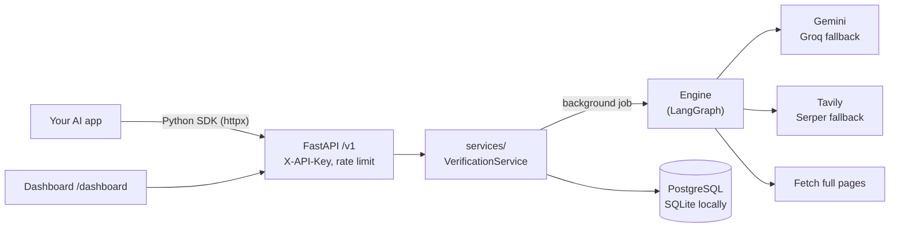
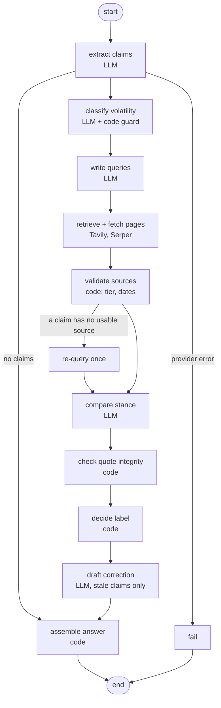
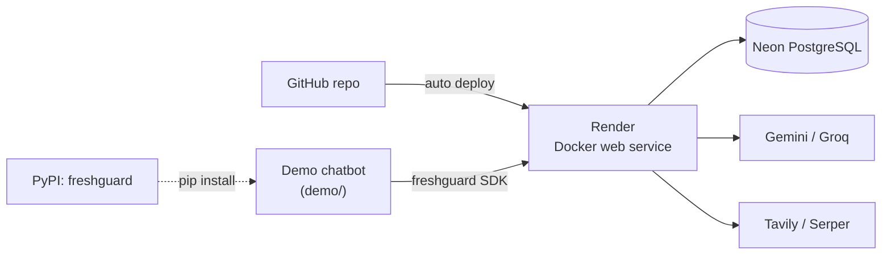

# Architecture

FreshGuard checks an AI answer against current web sources and returns one of four labels
(`fresh`, `stale`, `potentially_stale`, `unverifiable`) with the evidence it relied on.

One rule shapes the whole design: **language models read, code decides.** Models extract claims,
rate how fast a claim goes out of date, write search queries, compare a source with a claim and
draft a correction. They never score evidence, tier a source or choose the label. Those are
deterministic functions in `backend/app/engine/rules/`.

## System overview

| Layer | Folder | Responsibility |
|---|---|---|
| API | `backend/app/api/` | Routes, API-key check, rate limiting, one error format, request ids, the embedded dashboard page |
| Services | `backend/app/services/` | Creates records, runs the engine as a background job, stores the result, re-verification |
| Engine | `backend/app/engine/` | The verification workflow, providers (LLM, search, fetch) and the deterministic rules |
| Store | `backend/app/db/` | Records in memory (tests), SQLite or PostgreSQL |
| Schemas | `backend/app/schemas/` | Pydantic v2 models shared by every layer |
| SDK | `sdk/freshguard/` | Thin sync and async HTTP client. No verification logic |

**Dependency rule:** `schemas` <- `engine`; `schemas` <- `db`; `engine` and `db` <- `services`;
`services` <- `api`. The engine never imports `api` or `db`. A test (`tests/unit/test_architecture.py`)
enforces this.

## How a request flows

1. The app calls `client.verify(answer=..., question=...)`. The API checks `X-API-Key`, applies the
   rate limit and validates the body, then returns **202** with a verification id immediately.
2. The service runs the engine as a background job. The caller polls `GET /v1/verifications/{id}`
   (the SDK's `wait()` does this) until the status is `completed` or `failed`.
3. The finished record holds the answer-level label and confidence, and for each claim its label,
   reason and evidence (URL, tier, date, stance, quote).
4. `POST /v1/verifications/{id}/reverify` runs the same check again later and links the new
   record to the old one.

Jobs run inside the API process. A restart marks jobs that were running as failed. A durable queue
is future work.

## The verification graph

| Step | Who does it | What it does |
|---|---|---|
| extract | LLM | Splits the answer into short, checkable claims |
| classify | LLM + code | Rates each claim `fast`, `slow` or `static`. A code guard lifts a `static` rating to `slow` when the claim is about who holds a role (office and title words) |
| queries | LLM | Writes search queries for each time-sensitive claim |
| retrieve | Tavily (Serper fallback) | Returns candidate pages. Results are cached briefly to save free-tier quota, but empty results and errors are never cached |
| validate | code | Fetches each page, reads its publish and last-modified dates, assigns a source tier, drops unusable pages |
| stance | LLM | Says whether each page supports, contradicts or is neutral on the claim, and copies a quote |
| integrity | code | Keeps a quote only if it is a verbatim substring of the fetched page. Anything else is discarded |
| decide | code | Applies the decision table (below) |
| correct | LLM + code | For `stale` claims only. A correction may rest only on contradicting quotes from sources that are recent for the claim, and its numbers and names must appear in the cited quote |
| assemble | code | The answer takes the label of its worst claim |

## Deterministic rules

Full detail in [RULES.md](RULES.md). In short:

- **Source tiers:** 1 = government, `.int`, academic, standards bodies; 2 = a curated list of major
  newsrooms and reference or vendor sites; 3 = everything else.
- **Freshness windows:** fast 30 days, slow 365 days, static none.
- **Recent:** published inside the window. Undated or future-dated evidence is never recent. For tier 1
  and 2 pages, a later "last modified" date replaces the publish date (D38, D39).
- **Strong evidence:** verified (quote checked), credible (tier 1 or 2) and recent.
- **Decision table (first match wins):** no verified evidence gives `unverifiable` (or `fresh` for
  static claims); strong contradiction gives `stale`; strong support gives `fresh`; strong support
  that is contested, conflicting strong sources, or only weak evidence give `potentially_stale`.
- **Confidence** comes from tier weights, recency and corroboration. It is not a model's own guess.

## Providers and failure handling

- **LLMs:** Gemini first, Groq as a fallback, through LangChain adapters. Secrets are never logged.
- **Search:** Tavily first, Serper as a fallback, behind one interface.
- **Fetch:** a plain HTTP fetcher with timeouts and size limits. Some sites block it (HTTP 403), and
  those pages are skipped, not guessed.
- **Provider unavailable:** the record fails with a clear error. FreshGuard never returns a made-up
  label to cover an outage.
- **Fake providers** exist for tests only, and settings validation forbids them in production.

## Storage

Each verification is one record: input, status, result, timings and metadata. Re-verifications store
a `reverified_from` link. Production uses PostgreSQL (Neon); local runs and tests use SQLite.
`postgresql://` URLs are normalized for the `psycopg` driver.

## Deployment

`render.yaml` and `backend/Dockerfile` define the service. Secrets (API keys, database URL) are set in
Render and never committed. The free instance sleeps when idle, so the first request after a pause
can take up to a minute. See [DEPLOY.md](DEPLOY.md).

## Dashboard

`GET /dashboard` serves one HTML page from the API. After the viewer enters the API key, it lists
verifications with label counts and filters, and shows each claim with its evidence quotes. It also
has a Re-verify button and a form to check a new answer.

## Demo chatbot

`demo/` is a LangGraph + Gemini + Chroma chatbot whose knowledge base deliberately holds outdated
documents. It answers at once, submits the answer to FreshGuard through the SDK in the background,
and shows a badge when the verdict arrives. It is a client of the public API, not part of the engine.

## Testing

- Unit tests for every rule, node and provider adapter, plus API, service and SDK tests (580+).
- A benchmark of 81 hand-labeled claims in `benchmark/`, run against a live server. Results and
  their limits are in the README.
- CI (GitHub Actions) runs ruff and pytest for the backend, SDK and benchmark.

## Known limits

- Jobs run in-process, and verification takes 10 to 60 seconds on free-tier models.
- Free-tier quotas can interrupt runs.
- Many pages carry no date, and some trusted sites block fetching. Both push labels toward the
  cautious `potentially_stale`.
- The benchmark is small and was used during development, so it is a measurement, not a guarantee.

Design decisions and their trade-offs are recorded in [DECISIONS.md](DECISIONS.md).